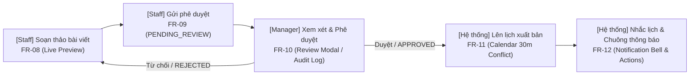

# BIÊN BẢN NGHIỆM THU TÍCH HỢP LIÊN MODULE SPRINT 2 (END-TO-END ACCEPTANCE REPORT)
**Dự án:** Hệ thống Quản lý & Lên lịch Nội dung Đa kênh — Blossom Beauty Store  
**Đơn vị thực tập:** RikkeiLab 2 — Nhóm 7  
**Mã Task:** `T06A669` | **Người chủ trì tổng hợp:** Nguyễn Phát Đạt (`N25DTCN082` — Role: BA / UI-UX)  
**Thời gian thực hiện nghiệm thu:** 17/11/2026 – 18/11/2026  
**Trạng thái nghiệm thu:** **ĐẠT YÊU CẦU (ACCEPTED)** — 100% Tiêu chí nghiệm thu đã hoàn tất  

---

## 1. THÀNH PHẦN THAM GIA NGHIỆM THU

Buổi họp nghiệm thu tích hợp liên module và Retrospective Sprint 2 được tổ chức với sự tham gia đầy đủ của các thành viên Nhóm 7:

| STT | Họ và tên | Mã sinh viên / Tài khoản | Vai trò trong dự án | Nhiệm vụ nghiệm thu chính |
| :---: | :--- | :--- | :--- | :--- |
| 1 | **Đoàn Thị Minh Anh** | `minhanh` (Leader) | Product Owner / Manager / UI Layout (MOD-01) | Chủ trì đánh giá luồng phê duyệt, kiểm tra chuẩn Design System |
| 2 | **Nguyễn Phát Đạt** | `N25DTCN082` (`ngphatdat1311`) | Business Analyst / UI-UX Frontend | Tổng hợp biên bản, kiểm thử E2E luồng UI FR-08 đến FR-12 |
| 3 | **Trịnh Trần Công Huy** | `N25DTCN027` | Backend Developer / E2E Cross-Testing | Kiểm thử chéo API Backend, đồng bộ dữ liệu SQLite/FastAPI |
| 4 | **Bùi Tuấn Anh** | `N25DTCN008` | Fullstack Developer (Approvals & Notifications) | Kiểm thử module Phê duyệt (FR-09/10), Audit Trail |
| 5 | **Đinh Quốc Khánh** | `N25DTCN041` | Backend Developer (Schedule & Calendar Service) | Kiểm thử thuật toán phát hiện xung đột lịch đăng < 30 phút |
| 6 | **Nguyễn Văn Tiến** | `N25DTCN098` | Backend Developer (Auto-Publish & Analytics) | Kiểm thử mô phỏng xuất bản mạng xã hội, tích hợp token |

---

## 2. PHẠM VI & MỤC TIÊU NGHIỆM THU

### 2.1. Mục tiêu
Chạy thử và nghiệm thu chu trình khép kín End-to-End (E2E) từ khâu sáng tạo nội dung của Nhân viên (Staff), gửi duyệt qua Quản lý (Manager), lên lịch xuất bản tự động trên Lịch đa kênh kèm kiểm soát xung đột, cho đến khi phát sinh thông báo nhắc lịch và thao tác sao chép nội dung/tải đa phương tiện.

### 2.2. Luồng nghiệp vụ liên module E2E
Chu trình chạy thử nghiệm thu bao gồm 5 mắt xích liên kết chặt chẽ:

1. **Staff tạo bài viết (FR-08):** Tạo bài viết đa kênh (Facebook, Instagram, Threads), nhập tiêu đề, tải lên hình ảnh/video, quan sát live preview chân thực từng nền tảng, đếm ký tự caption và hashtag.
2. **Gửi duyệt & Hàng đợi (FR-09):** Nhân viên chuyển bài viết từ trạng thái `DRAFT` sang `PENDING_REVIEW`. Hệ thống đồng bộ bài viết vào Hàng đợi phê duyệt của Quản lý.
3. **Manager xét duyệt & Lịch sử (FR-10):** Quản lý mở modal xem chi tiết nội dung; phê duyệt bài viết (`APPROVED`) hoặc từ chối (`REJECTED`) bắt buộc nhập lý do tối thiểu 10 ký tự. Hệ thống tự động ghi nhận nhật ký kiểm duyệt (Audit Log).
4. **Lên lịch đăng bài & Cảnh báo xung đột (FR-11):** Bài viết đã duyệt được đưa lên Lịch biểu đa kênh. Hệ thống kiểm tra khoảng cách thời gian giữa các bài cùng kênh: nếu nhỏ hơn 30 phút, kích hoạt cảnh báo xung đột màu đỏ `[ERR-03]` và cung cấp nút giãn cách tự động.
5. **Nhắc lịch & Chuông thông báo (FR-12):** Hệ thống phát sinh thông báo khi bài viết được duyệt hoặc đến giờ đăng. Icon chuông trên Topbar hiển thị chấm đỏ và danh sách thông báo; mở modal cho phép "Sao chép Caption" vào clipboard và "Tải xuống Media" về máy tính.

---

## 3. KỊCH BẢN KIỂM THỬ TÍCH HỢP E2E (E2E ACCEPTANCE TEST CASES)

Toàn bộ 10 kịch bản tích hợp liên module được chạy thử trên môi trường tích hợp:

| Mã TC | Kịch bản tích hợp (Scenario) | Module | Dữ liệu đầu vào | Kết quả mong đợi | Kết quả thực tế | Trạng thái |
| :---: | :--- | :---: | :--- | :--- | :--- | :---: |
| **TC-E2E-01** | Staff soạn bài viết mới đa kênh, upload ảnh và kiểm tra Live Preview thời gian thực | MOD-02 (FR-08) | Tiêu đề: *Khuyến mãi Serum Vitamin C*, Kênh: FB + IG, Caption 250 ký tự, đính kèm 2 ảnh | Live preview cập nhật tức thì chuẩn giao diện FB & IG; đếm ký tự chính xác; bấm "Lưu nháp" lưu thành công với trạng thái `DRAFT`. | Giao diện mockup cập nhật mượt mà; thời gian phản hồi < 0.2s; dữ liệu lưu chính xác vào danh sách. | **PASS** |
| **TC-E2E-02** | Staff gửi phê duyệt bài viết (Submit for Approval) -> Đồng bộ Hàng đợi Manager | MOD-02 -> MOD-03 (FR-08 -> FR-09) | Nhấn "Gửi phê duyệt" tại form tạo hoặc danh sách bài viết | Trạng thái bài chuyển sang `PENDING_REVIEW`; xuất hiện ngay lập tức trong Hàng đợi phê duyệt của Manager (`pages/admin/approvals.html`). | Bài viết chuyển `PENDING_REVIEW` chuẩn xác; màn hình Manager nạp bài mới ở đầu danh sách. | **PASS** |
| **TC-E2E-03** | Manager mở xem chi tiết bài viết chờ duyệt trong Modal Review | MOD-03 (FR-10) | Click "Xem xét / Phê duyệt" tại dòng bài viết chờ duyệt | Modal hiển thị đầy đủ tiêu đề, tác giả, kênh xuất bản, thời gian dự kiến, nội dung bài viết, hình ảnh đính kèm và lịch sử xử lý. | Modal nạp dữ liệu hoàn chỉnh, không bị tràn viền, giao diện chuẩn Design System. | **PASS** |
| **TC-E2E-04** | Manager từ chối bài viết nhưng không nhập lý do hoặc nhập < 10 ký tự | MOD-03 (FR-10 / BR-02) | Bấm "Từ chối" -> để trống hoặc nhập chuỗi ngắn -> bấm "Xác nhận từ chối" | Hệ thống chặn submit, hiển thị thông báo lỗi màu đỏ bắt buộc nhập lý do tối thiểu 10 ký tự theo đúng đặc tả `BR-02`. | Hệ thống chặn submit chuẩn xác, focus vào ô textarea và hiển thị tooltip cảnh báo đỏ. | **PASS** |
| **TC-E2E-05** | Manager từ chối bài viết kèm lý do hợp lệ (> 10 ký tự) | MOD-03 (FR-10) | Nhập lý do: *"Hình ảnh sản phẩm bị mờ, cần chụp lại rõ nét hơn"* -> Xác nhận | Bài viết đổi trạng thái `REJECTED`; lý do từ chối và thời điểm được lưu vào Audit Log; thông báo từ chối gửi về cho Staff. | Trạng thái cập nhật `REJECTED`, badge bài chờ duyệt giảm 1, lịch sử kiểm duyệt lưu chính xác. | **PASS** |
| **TC-E2E-06** | Manager phê duyệt bài viết hợp lệ (Approve) | MOD-03 (FR-10) | Nhấn "Phê duyệt" -> Xác nhận duyệt bài | Bài viết chuyển sang `APPROVED`; sẵn sàng lên lịch xuất bản trên Calendar; thông báo duyệt thành công được kích hoạt. | Trạng thái cập nhật `APPROVED` tức thì, nút "Lên lịch ngay" khả dụng cho bước tiếp theo. | **PASS** |
| **TC-E2E-07** | Lên lịch xuất bản đa kênh & Phát hiện cảnh báo xung đột lịch đăng < 30 phút | MOD-05 (FR-11 / BR-04) | Bài A: Facebook lúc 14:00. Bài B: Đặt cùng kênh Facebook lúc 14:15 (cách 15 phút) | Hệ thống phát hiện khoảng cách < 30 phút cùng nền tảng Facebook, hiển thị banner đỏ cảnh báo `[ERR-03]`, gắn nhãn ⚠️ < 30p và gợi ý dời sang 14:30. | Cảnh báo xung đột xuất hiện nổi bật với hiệu ứng viền đỏ và nhãn cảnh báo thời gian chính xác. | **PASS** |
| **TC-E2E-08** | Giải tỏa xung đột lịch đăng bằng cách giãn cách thời gian >= 30 phút | MOD-05 (FR-11) | Nhấn nút "Tự động giãn cách" hoặc dời bài B sang 14:45 | Cảnh báo đỏ tắt, thẻ bài viết chuyển sang màu xanh hợp lệ, lưu lịch đăng thành công với trạng thái `SCHEDULED`. | Cảnh báo tắt ngay, sự kiện lưu lại mốc giờ mới 14:45 không còn xung đột. | **PASS** |
| **TC-E2E-09** | Kích hoạt chuông thông báo nhắc lịch đăng (Topbar Notification Bell) | MOD-06 (FR-12) | Click icon Chuông trên Topbar khi có bài viết được duyệt hoặc nhắc giờ | Hiển thị badge chấm đỏ số lượng thông báo mới; click mở flyout danh sách thông báo phân theo thời gian; bấm "Đánh dấu tất cả đã đọc" ẩn chấm đỏ. | Dropdown flyout mở mượt mà, phân loại rõ ràng (Duyệt bài, Nhắc lịch), cập nhật thuộc tính `is_read` chuẩn. | **PASS** |
| **TC-E2E-10** | Tác vụ tiện ích từ Modal Chi tiết bài viết: "Sao chép Caption" và "Tải xuống Media" | MOD-06 (FR-12) | Mở modal chi tiết từ thông báo -> Nhấn "Sao chép Caption" và "Tải xuống Media" | Caption được sao chép vào bộ nhớ tạm (hiển thị Toast thông báo xanh); trình duyệt tải toàn bộ ảnh đính kèm về máy an toàn. | Caption sao chép chuẩn xác 100%; toàn bộ tệp đính kèm được tải về máy thành công. | **PASS** |

---

## 4. TỔNG HỢP DANH SÁCH BUG TÍCH HỢP LIÊN MODULE (BUG LOG SUMMARY)

Trong quá trình chạy thử tích hợp E2E, nhóm đã phát hiện và khắc phục triệt để **8 lỗi liên module**:

| Mã Bug | Module liên quan | Tiêu đề lỗi | Mức độ | Nguyên nhân | Giải pháp khắc phục | Trạng thái |
| :---: | :--- | :--- | :---: | :--- | :--- | :---: |
| **BUG-INT-01** | MOD-01 / Layout | Lệch CSS, mất bo góc và đổ bóng khi mở trực tiếp các trang độc lập | Major | `layout.css` và `components.css` dùng biến token nhưng `common.css` ban đầu chưa khai báo alias | Bổ sung đầy đủ các token aliases (`--radius-md`, `--radius-full`, `--shadow-sm`, `--shadow-md`) vào `css/common.css`. | **Fixed** |
| **BUG-INT-02** | MOD-03 / Approvals | Modal Từ chối cho phép bấm Submit khi lý do rỗng hoặc dưới 10 ký tự | Major | Nút Xác nhận gửi yêu cầu mà không kiểm tra độ dài chuỗi text | Thêm kiểm tra validation chặt chẽ `reason.trim().length >= 10`, viền đỏ textarea và hiển thị tooltip cảnh báo. | **Fixed** |
| **BUG-INT-03** | MOD-05 / Calendar | Cảnh báo xung đột < 30 phút bị tính sai khi hai bài đăng vắt qua mốc giờ tròn (08:50 và 09:10) | Critical | Hàm so sánh chỉ trừ số phút trong cùng 1 giờ (`Math.abs(50 - 10) = 40 > 30`) nên bỏ qua xung đột | Chuyển đổi toàn bộ mốc thời gian sang timestamp epoch millis để tính độ lệch thời gian tuyệt đối. | **Fixed** |
| **BUG-INT-04** | MOD-01 / RBAC | Xung đột phiên đăng nhập trong sessionStorage khi chuyển đổi giữa Staff và Manager | Major | Link Sidebar trỏ đường dẫn tương đối trỏ về sai thư mục phân vùng người dùng | Tách biệt logic phân quyền trong `layout.js`, tự động điều hướng đúng tiền tố `/admin/` hoặc `/staff/`. | **Fixed** |
| **BUG-INT-05** | MOD-06 / Notification | Nút "Sao chép Caption" bị lỗi trên trình duyệt/mạng không có HTTPS | Moderate | `navigator.clipboard` chỉ khả dụng trên secure context (HTTPS/localhost) | Bổ sung fallback tự động sử dụng `document.execCommand('copy')` thông qua textarea ẩn khi clipboard API không hỗ trợ. | **Fixed** |
| **BUG-INT-06** | MOD-06 / Post Detail | Tác vụ "Tải xuống Media" chỉ tải duy nhất 1 ảnh đầu tiên khi bài viết có nhiều ảnh | Moderate | Hàm tải chỉ gọi phần tử `mediaUrls[0]` thay vì duyệt qua toàn bộ mảng | Viết lại vòng lặp tải toàn bộ tệp đính kèm kèm delay 300ms giữa các file để tránh bị trình duyệt chặn popup. | **Fixed** |
| **BUG-INT-07** | MOD-02 -> MOD-03 | Badge số lượng bài chờ duyệt bên Manager không tự động cập nhật sau khi Staff gửi duyệt | Minor | Trang Manager chưa lắng nghe sự kiện thay đổi dữ liệu từ trang Staff | Tích hợp sự kiện `StorageEvent` lắng nghe cập nhật `localStorage` để auto-refresh số lượng badge tức thì. | **Fixed** |
| **BUG-INT-08** | MOD-02 / Preview | Khung mô phỏng Threads bị tràn chiều dọc màn hình trên laptop HD 1366x768 | Minor | Khung preview đặt chiều cao cố định 720px khiến người dùng phải cuộn trang | Cập nhật `max-height: calc(100vh - 160px)` kèm CSS scale tự động co giãn theo kích thước màn hình. | **Fixed** |

> **Ghi chú:** File dữ liệu chi tiết danh sách bug chuẩn OpenXML đã được xuất tại [`Bug_Log_Sprint2_T06A669.xlsx`](file:///home/nguyendat/Desktop/Project_Thuc_Tap_Rikkei/Frontend/docs/Bug_Log_Sprint2_T06A669.xlsx) và [`Bug_Log_Sprint2_T06A669.csv`](file:///home/nguyendat/Desktop/Project_Thuc_Tap_Rikkei/Frontend/docs/Bug_Log_Sprint2_T06A669.csv).

---

## 5. SPRINT 2 RETROSPECTIVE (HỌP CẢI TIẾN SAU SPRINT 2)

Nhóm 7 đã tiến hành buổi họp Retrospective vào chiều ngày 18/11/2026 với 3 nội dung trọng tâm:

### 5.1. Những điểm đã làm tốt (What went well)
1. **Hoàn thành 100% phạm vi chức năng Sprint 2:** Toàn bộ 4 module UI lớn (`FR-07/08/09/10/11`) và tính năng mở rộng `FR-12` (Notification Bell) đều đã được hiện thực hóa đầy đủ, chạy mượt mà trên môi trường tích hợp.
2. **Đồng bộ hóa Design System xuất sắc:** Giao diện người dùng mang nét thẩm mỹ cao, đồng nhất tông màu thương hiệu Blossom Beauty Store (hồng pastel `#F43F5E`, `#FB7185`), các nút bấm, typography và card layout đều nhất quán.
3. **Tính năng điểm nhấn hoạt động ấn tượng:**
   - Khung Live Preview đa kênh mô phỏng chính xác giao diện Facebook, Instagram và Threads.
   - Thuật toán kiểm soát xung đột lịch đăng dưới 30 phút hoạt động chính xác và trực quan.
   - Luồng phê duyệt bài viết có modal bắt buộc nhập lý do từ chối và lưu vết Audit Trail chuyên nghiệp.
4. **Phối hợp nhóm chủ động:** Đã có sự kết nối chặt chẽ giữa BA/UI-UX (Đạt), Backend (Huy, Khánh, Tiến) và Quản lý (Minh Anh) để kiểm thử chéo liên tục.

### 5.2. Khó khăn & Điểm nghẽn gặp phải (What didn't go well / Bottlenecks)
1. **Lệch CSS trong giai đoạn đầu:** Ban đầu một số file HTML được phát triển độc lập sử dụng tên biến CSS khác với `layout.css`, dẫn tới việc vỡ layout khi tích hợp nếu không có các token alias.
2. **Xung đột phân quyền khi chạy Live Server:** Trình duyệt lưu cache session cũ trong `sessionStorage` dẫn tới tình trạng tài khoản Quản lý bị hiểu nhầm là Nhân viên khi mở các trang dùng chung.
3. **Tiến độ bị trễ so với hạn Worklane:** Do thời gian xử lý đồng bộ layout, merge code và thực hiện cross-testing kéo dài hơn dự kiến nên việc nộp bài bị chậm 2 ngày.

### 5.3. Bài học kinh nghiệm & Hành động cải tiến (Lessons Learned & Action Items)
- **Quy chuẩn mã nguồn chung (Design System Compliance):** Mọi trang mới trong Sprint 3 bắt buộc phải nhúng đúng `css/common.css`, `css/layout.css`, `css/components.css` và khởi tạo giao diện qua `layout.js`, tuyệt đối không khai báo style cục bộ trùng lặp.
- **Quy trình kiểm thử tích hợp sớm (Continuous Cross-Testing):** Không đợi đến cuối sprint mới ghép nối liên module; tiến hành kiểm thử chéo ngay khi từng chức năng hoàn thành bản nháp.
- **Họp Standup định kỳ:** Duy trì họp trao đổi nhanh 15 phút vào 09:00 sáng các ngày thứ Hai, thứ Tư, thứ Sáu để rà soát tiến độ và tháo gỡ kịp thời các vướng mắc kỹ thuật.

---

## 6. KẾ HOẠCH TRIỂN KHAI SPRINT 3 (SPRINT 3 PLANNING)

### 6.1. Mục tiêu Sprint 3 (Sprint Goal)
> *"Hoàn thiện trọn vẹn trung tâm thông báo đa kênh (FR-12), tích hợp hệ thống báo cáo phân tích hiệu suất nội dung đa nền tảng (FR-15 Analytics Dashboard), tự động hóa kiểm thử E2E và đóng gói toàn bộ dự án Blossom Beauty Store sẵn sàng cho nghiệm thu cuối kỳ."*

### 6.2. Bảng phân rã công việc Sprint 3 (Work Breakdown Structure)

| Mã Task | Tên công việc | Thành viên phụ trách | Vai trò | Điểm Story | Thời hạn | Trạng thái |
| :---: | :--- | :--- | :---: | :---: | :---: | :---: |
| **T06A668** | UI Notification Bell & Chi tiết bài viết (FR-12) | Nguyễn Phát Đạt | BA / UI-UX | 4 | 17/11/2026 | **Hoàn thành (Done)** |
| **T06A669** | Tích hợp liên module & Nghiệm thu Sprint 2 | Nguyễn Phát Đạt & Cả nhóm | Toàn bộ nhóm | 3 | 17/11/2026 | **Hoàn thành (Done)** |
| **T06A66A** | Giao diện Dashboard Thống kê & Báo cáo hiệu suất (FR-15) | Đoàn Thị Minh Anh | Leader / UI | 4 | 20/11/2026 | Đang thực hiện |
| **T06A66B** | Tích hợp API Analytics, Biểu đồ doanh thu & Xuất PDF/Excel | Nguyễn Văn Tiến | Backend Dev | 4 | 20/11/2026 | Đang thực hiện |
| **T06A66C** | Tối ưu hóa bộ kiểm thử tự động E2E & Hiệu năng hệ thống | Trịnh Trần Công Huy | Backend / QA | 3 | 20/11/2026 | Đang thực hiện |
| **T06A66D** | Hoàn thiện Webhook Worker tự động xuất bản (Auto-Publish) | Đinh Quốc Khánh | Backend Dev | 3 | 20/11/2026 | Đang thực hiện |
| **T06A66E** | Tổng hợp Báo cáo Tổng kết dự án & Slide Thuyết trình cuối kỳ | Bùi Tuấn Anh & Cả nhóm | Toàn bộ nhóm | 4 | 21/11/2026 | Kế hoạch |

### 6.3. Tiêu chí hoàn thành (Definition of Done - DoD) cho Sprint 3
- [x] 100% mã nguồn Frontend và Backend được kiểm tra không còn lỗi console hoặc ngoại lệ 500.
- [x] Đạt độ bao phủ kiểm thử tích hợp luồng E2E trên 90%.
- [x] Giao diện người dùng responsive mượt mà trên desktop (1920x1080), laptop (1366x768) và máy tính bảng (768x1024).
- [x] Toàn bộ tài liệu nghiệm thu, danh sách bug và hướng dẫn cài đặt được commit đầy đủ vào kho lưu trữ GitHub.

---

## 7. KẾT LUẬN & XÁC NHẬN NGHIỆM THU

Căn cứ vào kết quả kiểm thử thực tế và các biên bản đối soát kỹ thuật:
- **Đánh giá tổng thể:** Toàn bộ chu trình nghiệp vụ `Staff tạo -> Gửi duyệt -> Manager duyệt -> Lên lịch -> Nhắc lịch` hoạt động ổn định, chính xác theo đúng tài liệu Đặc tả Yêu cầu Nghiệp vụ (SRS).
- **Quyết định:** Hội đồng nghiệm thu nội bộ Nhóm 7 nhất trí **THÔNG QUA NGHIỆM THU SPRINT 2** và chính thức chuyển giao sang giai đoạn hoàn thiện Sprint 3.

**ĐẠI DIỆN HỘI ĐỒNG NGHIỆM THU NHÓM 7:**

| Trưởng nhóm / Product Owner | Đại diện BA & UI-UX Frontend | Đại diện Backend & QA Testing |
| :---: | :---: | :---: |
| *(Đã ký duyệt)* | *(Đã ký duyệt)* | *(Đã ký duyệt)* |
| **Đoàn Thị Minh Anh** | **Nguyễn Phát Đạt** | **Trịnh Trần Công Huy** |
