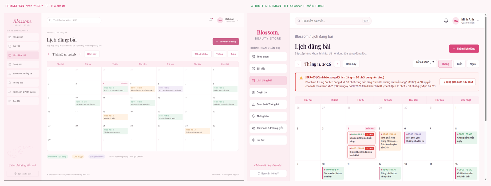
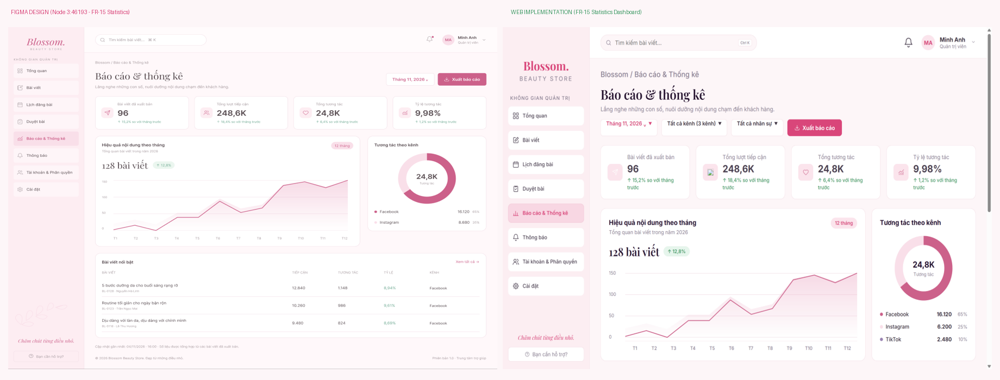
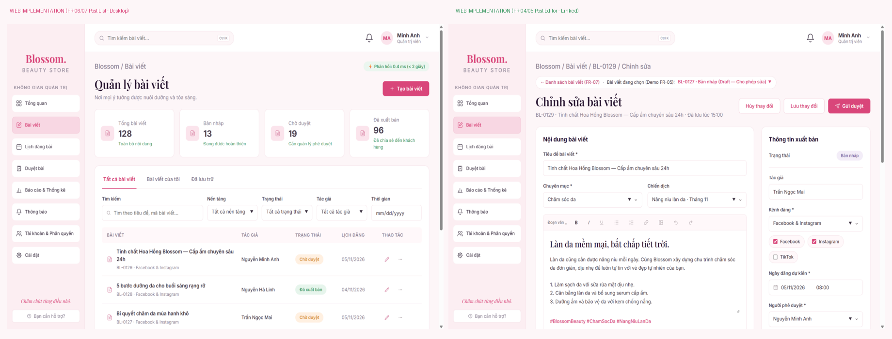
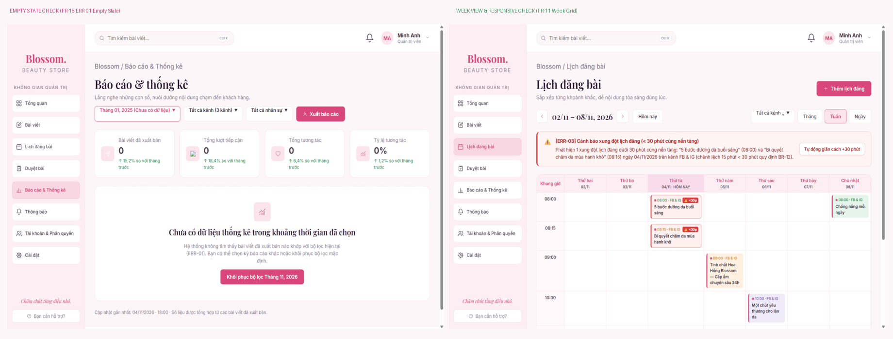

# [T06A671] Báo Cáo Rà Soát UI Theo Figma & Responsive — Blossom Beauty Store

**Người thực hiện:** Trịnh Trần Công Huy (`N25DTCN027`)  
**Mã task:** `T06A671` — Hoàn thiện UI theo Figma & responsive  
**Figma nguồn:** `Design_Demo` (`lZGM9w6DLqe4AaBvvCdyou`)

---

## 1. Danh mục rà soát Design Tokens, Khoảng cách & Trạng thái

| Hạng mục kiểm tra | Chuẩn hệ thống (`common.css` / Figma) | Kết quả rà soát & cập nhật |
| :--- | :--- | :--- |
| **Màu sắc thương hiệu** | Primary `#d9467a`, Soft `#fbe4ec`, Bg `#fdf6f8`, Border `#f4dce4`, Text `#3b3140` | Đã đồng bộ trên toàn bộ 5 màn hình (`posts`, `create-post`, `edit-post`, `calendar`, `reports`) |
| **Typography & Thanh tìm kiếm** | Tiêu đề `Playfair Display 35px/600`, Breadcrumb `20px`, Input/Button `Inter 15px`, bỏ ký tự lỗi font `⌘ K` | Đã chuẩn hóa trên toàn bộ trang, không bị chữ nhỏ hoặc lệch font |
| **Trạng thái Lỗi (Error States)** | `ERR-01` (khóa sửa Published, chặn xóa Published/Pending), `ERR-02` (sai định dạng file, đặt lịch quá khứ), `ERR-03` (xung đột `< 30p`) | Đầy đủ Banner cảnh báo, Toast và viền đỏ trực quan |
| **Trạng thái Rỗng (Empty States)** | `FR-07` (không tìm thấy bài / tab Đã lưu trữ trống), `FR-15` (`ERR-01` chưa có dữ liệu thống kê) | Đầy đủ khung Empty State + nút khôi phục bộ lọc mặc định |
| **Responsive (`<= 850px`, `<= 600px`)** | Chuyển grid 4 cột -> 2 cột -> 1 cột, bảng chuyển sang dạng thẻ card trên mobile, Calendar cuộn ngang mượt không vỡ khung | Đã bổ sung `@media (max-width: 850px)` và `@media (max-width: 600px)` cho toàn bộ CSS |

---

## 2. Ảnh So Sánh Figma vs Web

### 2.1. FR-11 Content Calendar (Figma `3:45302` vs Web + Conflict `ERR-03`)

### 2.2. FR-15 Statistics Dashboard (Figma `3:46193` vs Web)

### 2.3. FR-04/05/06/07 Quản lý & Biên tập Bài viết (Liên kết xuyên suốt)

### 2.4. Trạng thái Rỗng (Empty State `ERR-01`) & Chế độ Tuần (Week Grid)

